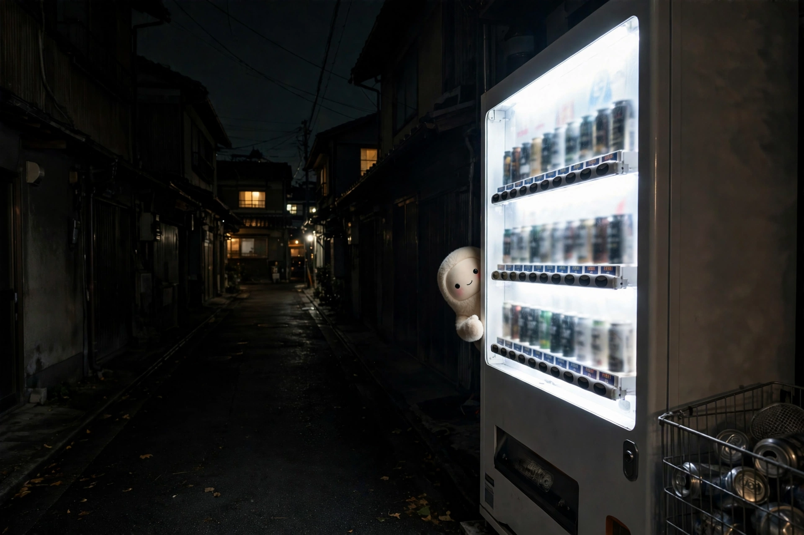
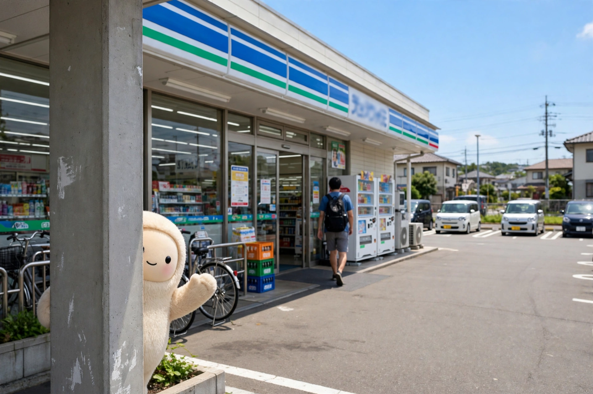
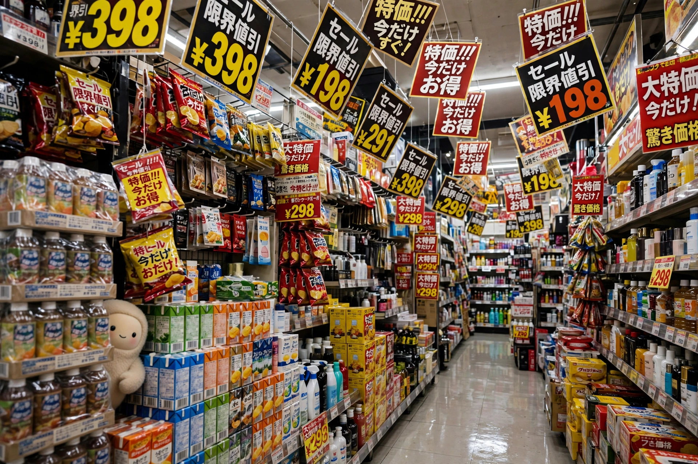
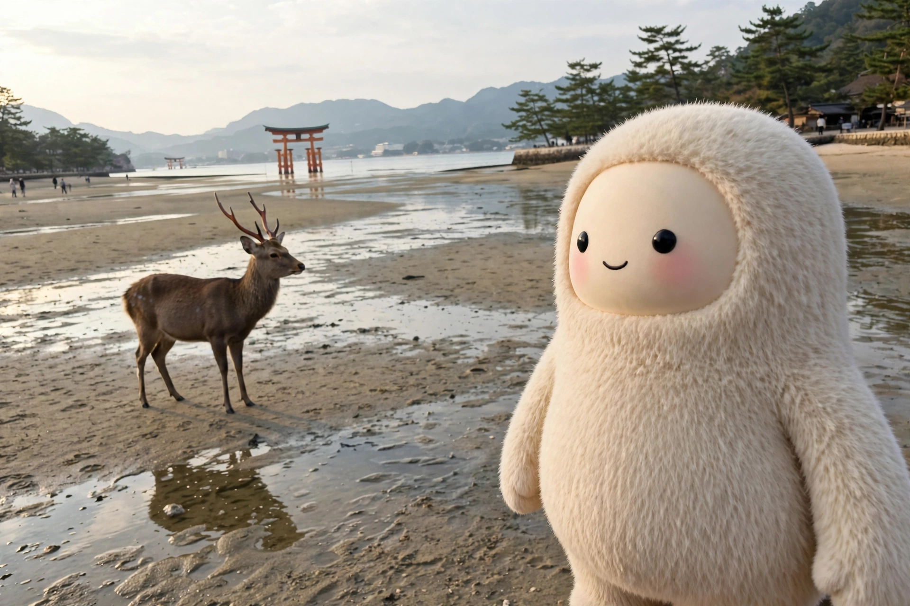

# japan-postcards-pack

A prompt pack for generating nostalgic "postcard from Japan" photos featuring the default Muse character.

The pack was built for a small toy: a space where Muse travels through Japan on your behalf and a postcard — one photo, with a short handwritten-style message — is waiting for you once a day. It is a *revisit* toy, aimed at people who have been to Japan and want to walk their memories once more: Muse re-walks a region they miss, and the postcards lean everyday (roughly 3 parts sightseeing to 7 parts ordinary life, as a guideline within the chosen region rather than a fixed ratio).

The core insight of the pack is that the photos must not look like tourist posters. They should look like unpolished smartphone snapshots a traveler happened to take — slightly tilted, a little awkwardly cropped, full of the ordinary clutter of real places — with a small cream-colored plush character, about 1 m tall, somewhere in the frame.

> **If you are an AI agent asked to build this: start with [`BUILD.md`](BUILD.md).** It is the work order — what to read in what order, and the steps from reference image to a finished, walked-through Space.

## Examples

Generated with this pack's guide and place cards (see `docs/qa-field-notes.md` for how they were judged):

*A single vending machine in a dark alley — the prototype the whole pack grew from.*

*An everyday scene in flat daylight — currently the strongest combination in QA.*

*Don Quijote (Donki), after its key features were verbalized from real photos.*

*Miyajima's great torii at low tide — the tide directive missed, the shot kept (see the field notes on judging tolerance).*

## What's inside

- **`BUILD.md`** — the build brief for an AI agent: the read order for the whole pack, and the step-by-step from obtaining the character reference image through generating and checking the photo pool to building the Space and walking the full trip once before handover, with a definition-of-done checklist.
- **`docs/generation-guide.md`** — the generation guide: why AI travel photos look fake, a reusable prompt template (fixed text + variables), time-of-day and action presets, per-place-type adjustments, a deep dive on Meiji Jingu, how to add the handwritten line without breaking it (composite it afterwards — don't generate it), and a failure checklist. It also classifies famous places into four types (A: atmosphere/experience, B: recognizable by a part, C: the shape itself, D: signage) and gives a rule for stepping the shot down a level when a place won't hold up.
- **`docs/place-cards.md`** — place cards for 18 places (Shibuya Scramble Crossing, Meiji Jingu, Takeshita Street, Senso-ji, Miyajima, Fushimi Inari, Kiyomizu-dera, the Arashiyama bamboo grove, Omoide Yokocho, Golden Gai, Don Quijote, an ordinary izakaya, a matcha cafe, a convenience store, a Yamanote Line platform, a residential back street at night, an onsen, and an alley with a vending machine). Each card fixes, in advance, the one key feature that makes the place recognizable, the facts where the real place differs from AI's average image of it, the angle, how to handle the elements that break, the crowd density, and action restrictions — plus ready-to-use English prompt variables.
- **`docs/qa-field-notes.md`** — field notes from the QA process: the taste corrections that accumulated over the batches (don't lean Showa, don't lean exotic, no mosaics by default, Muse's size is a range rather than a fixed value…), the working principles that came out of them, a worked example of verbalizing a place from real photos (Don Quijote's six elements), and what tested strongest.
- **`docs/reproducibility.md`** — an honest note on what in this pack reproduces from the documents alone, what travels only as one person's calibrated starting values (the judging tolerance, the taste corrections), and what does not travel at all (how each place's key feature was discovered, the place selection, the generation pipeline). Read this before expecting the samples' quality out of the box.
- **`docs/space-spec.md`** — the specification of the Space itself: one postcard a day inside one fixed region, a route decided in advance, days advancing by the visitor's local date whether opened or not, the start flow (name, and the "What do you miss most about Japan?" choice), the sealed letter that flips into the postcard, the rules for the handwritten line, the minimal per-visitor state model, and what the pre-generated photo pool must contain.
- **`examples/`** — example generated photos: the photo layer of the postcards, before the handwritten line and paper band are composited in your own pipeline.

## How to use it

1. Attach a reference image of the default Muse character, so its shape, face, and felt plush texture stay consistent. (A screenshot of your own Muse's default avatar works; the pack can't redistribute the character's image.)
2. Pick a place card. Slot its variables (SPOT_DESCRIPTION, KEY_FEATURE, FACTS_AGAINST_STEREOTYPE, ANGLE_AND_CROP, PEOPLE, AVOID) into the template in the generation guide, and fill in the remaining variables — season, time of day, weather, clutter, Muse's action, light.
3. Generate the photo only. Keep Muse's height at about 1 m, vary how it appears (close-up, peeking from behind something, back view, small in a corner — not always full-body in the foreground), and never give it a peace sign: on fingerless mitten hands, a peace sign makes the model grow fingers. Raise one hand instead.
4. Composite the handwritten line in afterwards, as a separate step, on a cream paper band. Keep it short and quiet — the guide's rule is a line with room in it, like "Still here, still warm.", that does not pretend to know the recipient's memories.
5. Check the result against the guide's checklist and its two pass conditions: the image is free of breakage, *and* someone who has visited the place can recognize it as that place.

For a minimal run, the design's first test form is a 3-day Kyoto trip: Fushimi Inari in the morning, a vending machine at night, a matcha cafe in the afternoon — one postcard a day.

## Status

This pack is field-tested but still in an ongoing QA process. Every one of the 18 place cards has been generated at least once and judged; the QA field notes record the main corrections and a per-place judgment summary. Verification is partial, though: the place cards have not all been checked by people who know each place (the guide recommends exactly that check for each card's "facts that differ from the average image").

## License

The text and documentation in this repository are licensed under the [Creative Commons Attribution 4.0 International License (CC BY 4.0)](https://creativecommons.org/licenses/by/4.0/) — see the `LICENSE` file. The license covers the writing only: the default Muse character shown in the example images is not covered by it (see "Unofficial fan work" below), and the example images as a whole are not covered by the license either — they are included as documentation of the pack's output.

## Unofficial fan work

This is an unofficial fan work. It is not affiliated with Meta, and it is not an official Muse product. The character featured in the example images is the default Muse character; this pack contains prompts and notes for generating your own images, not official artwork.
